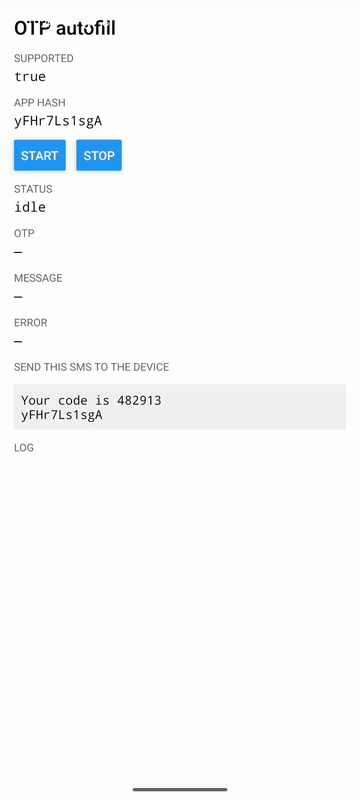

# React Native OTP Autofill

Reads one-time codes from SMS on Android with the [SMS Retriever API](https://developers.google.com/identity/sms-retriever/overview), with no SMS permission. A React Native Turbo Module that works in bare React Native and Expo apps.

[](https://www.npmjs.com/package/@avasapp/react-native-otp-autofill)




## Requirements

- React Native 0.76+ with the New Architecture (Expo SDK 52+)
- Android 7.0 (API 24)+ with Google Play Services

On iOS and web the library does nothing: `isSupported` is false and `waitForOtp` rejects with `UNSUPPORTED`. On iOS, set `textContentType="oneTimeCode"` on the input so the keyboard offers the code instead.

## Installation

```sh
npm install @avasapp/react-native-otp-autofill@next
```

v2 is in beta on the `next` tag. `latest` is still v1, which has a different API.

Bare React Native apps autolink it. Expo apps need a development build (`npx expo prebuild` or EAS Build); it does not work in Expo Go. No config plugin or permission is needed.

## Usage

### 1. Send the app hash with the SMS

The SMS must end with your app's 11-character hash, on its own line or at the end of the last line:

```
Your code is 482913

FA+9qCX9VSu
```

Read the hash at runtime and send it to the backend that sends the SMS:

```ts
import { getAppHash } from '@avasapp/react-native-otp-autofill'

const hash = await getAppHash() // null on iOS and web
```

The hash comes from the signing certificate, so debug, upload and Play App Signing builds each have a different one. Read it at runtime instead of hardcoding it.

The hash matches Google's sample. For an app that rotated its signing key it is the original key's hash, and with several signers it is the first signer's.

### 2. Wait for the code

```tsx
import { useOtp } from '@avasapp/react-native-otp-autofill'

function OtpScreen({ codeLength }: { codeLength: number }) {
  const { otp, status, start } = useOtp({
    length: codeLength,
    onOtp: (code) => input.current?.setCode(code),
  })

  async function resend() {
    await api.resendCode()
    start() // a resent code needs a wait, so re-arm after a resend
  }

  // status: 'idle' | 'listening' | 'received' | 'timeout' | 'error'
}
```

`useOtp` starts listening on mount and stops on unmount. Each wait ends after one SMS or when its session's 5 minutes end, so call `start()` again after a resend or a timeout.

Android gives an app one listening session, 5 minutes from when it opened. Starting again inside it does not extend it, so a wait that joins late is shorter. If Android closes a stale session during the wait, the library opens one new session and the wait gets 5 minutes from then. Android closes an expired session late, so an SMS sent after the window but before the old session closes can be lost. Arm right before sending the code, and keep resends inside the first 5 minutes or expect the first SMS after the window to be missed. The session is tracked in memory, so a JS reload (including expo-updates `reloadAsync`) or a restarted app process loses track of it.

Only one wait runs at a time. If another `useOtp` or `waitForOtp` starts, this hook goes back to `idle` with no error. The library knows nothing about navigation, so a screen that sits under another OTP screen should call `start()` when it is focused again.

Without React, use `waitForOtp`:

```ts
import { waitForOtp, OtpError } from '@avasapp/react-native-otp-autofill'

const controller = new AbortController()
try {
  const { otp, message } = await waitForOtp({
    length: 6,
    signal: controller.signal,
  })
} catch (error) {
  if (error instanceof OtpError && error.code === 'TIMEOUT') {
    // no SMS before the session window closed
  }
}

// later, e.g. when the screen closes
controller.abort()
```

## API

### `useOtp(options?)`

| Option      | Type                     | Default |                                                                      |
| ----------- | ------------------------ | ------- | -------------------------------------------------------------------- |
| `autoStart` | `boolean`                | `true`  | Start listening on mount.                                            |
| `length`    | `number`                 |         | Exact code length.                                                   |
| `pattern`   | `RegExp`                 |         | Custom matcher, instead of `length`.                                 |
| `onOtp`     | `(otp, message) => void` |         | Called when an SMS with a code arrives. Doesn't need to be memoized. |

Returns `{ status, otp, message, error, start, stop }`. `start()` replaces any wait in progress, including one from another hook. `stop()` cancels it and goes back to `idle`. When an SMS arrives with no matching code, `status` is `received` and `otp` is null.

### `waitForOtp(options?): Promise<{ otp, message }>`

Takes `length`, `pattern` and an optional `signal`. Resolves with the extracted code (or null) and the full SMS body. Only one wait runs at a time: starting a new one rejects the previous with `ABORTED`. Bad options reject with `INVALID_OPTIONS`.

### `getAppHash(): Promise<string | null>`

The app hash, or null on platforms without SMS Retriever.

### `extractOtp(message, options?): string | null`

The extraction `waitForOtp` uses, exported for tests and custom flows. It throws an `OtpError` with code `INVALID_OPTIONS` for bad options.

- It drops the app hash when it is the last word of the message.
- A candidate is a 4 to 8 digit number that stands alone. Digits inside a larger number (`1500.00`, `1,500`, `482-913`) or next to letters (`A1234`, `1234abc`) don't count. `length` changes the range to exactly `length` digits.
- The code is the one distinct candidate, and every run of 3 or more digits in the message, in any script, must be that same number. Otherwise it returns `null` instead of guessing. So `"Your OTP for order 7781 is 482913"` and `"Your code is 482 913. Valid until 14/10/2026"` give `null`: a split or non-ASCII code can't be read, and a rival number must not be returned in its place. The same number twice is fine.

If your SMS holds other numbers, such as an amount or an order number, use a `pattern` that matches the code. `length` alone does not help there.

`pattern` replaces all of these rules: the first capture group is the code, or the whole match if there is no group.

### `isSupported: boolean`

True on Android when the native module is linked.

### `setLogger(fn | null): () => void`

Sends log events to `fn` and returns a function that stops it. The returned function does nothing if another logger has replaced `fn` since. See [Logging](#logging).

### `OtpError`

Rejections are `OtpError`s with a `code`:

| Code              | Meaning                                                                                                                  |
| ----------------- | ------------------------------------------------------------------------------------------------------------------------ |
| `UNSUPPORTED`     | Not Android, or the native module isn't linked (e.g. Expo Go, or an app built without it).                               |
| `UNAVAILABLE`     | SMS Retriever couldn't start, usually because Google Play Services is missing or outdated.                               |
| `TIMEOUT`         | No SMS before the wait's session ended (up to 5 minutes), or 5 minutes after the one new session opened for a stale one. |
| `ABORTED`         | The signal aborted, or a newer wait replaced this one.                                                                   |
| `FAILED`          | Anything else; see `message`.                                                                                            |
| `INVALID_OPTIONS` | `length` and `pattern` were both set, `length` isn't a positive integer, or `pattern` isn't a RegExp.                    |

## Logging

Pass a function to `setLogger` once at startup to send the library's events to Sentry, PostHog or any other tool. Events never include the SMS body or the code.

```ts
import * as Sentry from '@sentry/react-native'
import { setLogger } from '@avasapp/react-native-otp-autofill'

setLogger(({ level, event, message, error, data }) => {
  if (level === 'error') {
    Sentry.captureException(error ?? new Error(message), {
      tags: { otp_event: event },
      extra: data,
    })
  } else if (level !== 'debug') {
    Sentry.addBreadcrumb({ category: 'otp', level, message, data })
  }
  posthog.capture(`otp_${event}`, { level, ...data })
})
```

Each event is `{ level, event, message, error?, data? }`:

| Event                  | Level         | When                                                                                                                                                                            |
| ---------------------- | ------------- | ------------------------------------------------------------------------------------------------------------------------------------------------------------------------------- |
| `wait.start`           | debug         | `waitForOtp` started; `data.length` and `data.customPattern`                                                                                                                    |
| `wait.received`        | info          | A code was found; `data.elapsedMs`, `data.codeLength`                                                                                                                           |
| `wait.no_match`        | warn          | An SMS arrived but no code matched. Usually the SMS format no longer fits `length` or `pattern`. `data.messageLength`                                                           |
| `wait.timeout`         | warn          | No SMS within the retriever's window; `data.elapsedMs`                                                                                                                          |
| `wait.aborted`         | debug         | Stopped, unmounted or replaced by a newer wait                                                                                                                                  |
| `wait.failed`          | warn or error | `warn` for `UNAVAILABLE` (no Play Services, a device condition), `error` for any other native failure; `error` is the `OtpError`, `data.code` its code                          |
| `wait.invalid_options` | error         | Bad `length` / `pattern` (`INVALID_OPTIONS`)                                                                                                                                    |
| `wait.unsupported`     | debug         | Called on iOS or web, or without the native module                                                                                                                              |
| `module.missing`       | error         | On Android the native module is not linked, usually JS updated over the air onto a build made without this library. Logged once, on the first `waitForOtp` or `getAppHash` call |
| `hash.missing`         | warn          | `getAppHash()` found no signing certificate                                                                                                                                     |
| `hash.failed`          | error         | `getAppHash()` threw                                                                                                                                                            |

A logger that throws is caught, so it can't break the OTP flow. Call `setLogger(null)`, or the function `setLogger` returned, to stop.

## Migrating from v1

v2 is a Turbo Module, so it no longer depends on `expo`, and it needs React Native 0.76+ with the New Architecture.

| v1                                                                           | v2                                                            |
| ---------------------------------------------------------------------------- | ------------------------------------------------------------- |
| `useGetHash()` → `{ hash }`                                                  | `getAppHash()` (returns one hash, not an array)               |
| `AvasOtpAutofill.getHash()` → `string[]`                                     | `getAppHash()` → `string \| null`                             |
| `addListener('onSmsReceived')` + `startOtpListener()` + `stopSmsRetriever()` | `useOtp()` or `waitForOtp({ signal })`                        |
| `onTimeout` / `onError` events                                               | `status` / `error` from `useOtp`, or the `OtpError` rejection |
| `useOtpListener()`                                                           | `useOtp()`                                                    |
| Filtering `otp.length === n` yourself                                        | `length: n`                                                   |
| Default export, `AvasOtpAutofill`, `AvasOtpAutofillModule`                   | Named exports only                                            |
| Deep imports like `/build/module`                                            | Import from the package root                                  |

A v1 listener effect such as:

```ts
useEffect(() => {
  const sub = AvasOtpAutofill.addListener('onSmsReceived', ({ otp }) => {
    if (otp?.length === codeLength) input.current?.setCode(otp)
  })
  AvasOtpAutofill.startOtpListener()
  return () => {
    sub.remove()
    AvasOtpAutofill.stopSmsRetriever()
  }
}, [codeLength])
```

becomes:

```ts
const { start } = useOtp({
  length: codeLength,
  onOtp: (otp) => input.current?.setCode(otp),
})
```

Call `start()` after a resend, which v1 code often didn't, so a resent code autofills too.

## Troubleshooting

- **No SMS arrives**: the message must end with exactly the hash from `getAppHash()` for the build that's running, and the message must be 140 bytes or less.
- **`UNSUPPORTED` on Android**: the native module isn't in the build, for example Expo Go, or a JS update shipped to a binary built without this library. Rebuild the app.
- **Logs**: `adb logcat -s OtpAutofill SmsBroadcastReceiver`. The SMS body is never logged.

## Contributing

See [CONTRIBUTING.md](CONTRIBUTING.md).

## License

MIT
